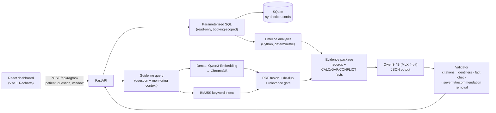

# DetoxRAG architecture

DetoxRAG is a hybrid **structured-data retrieval + document RAG** system. Each component has one responsibility, and the language model is deliberately the *last* and *least trusted* step.

## Responsibilities

| Layer | Module | Does | Never does |
|---|---|---|---|
| SQL retrieval | `backend/database/queries.py` | Parameterized, read-only queries filtered by **PatientID + BookingNumber + time window**; validates identifiers | Accept free-form SQL; return another booking's rows |
| Timeline analytics | `backend/services/timeline.py` | Scores (earliest/latest/change/min/max/direction), intervals, vitals summaries, medication status counts, documentation gaps, conflict flags | Classify severity or make clinical judgments |
| Guideline RAG | `backend/rag/*` | PDF → TOC-aware sections → recommendation-aware chunks → dense + BM25 → RRF | Fabricate page numbers or sections (all from the chunk store) |
| Evidence builder | `backend/services/evidence_builder.py` | Gives every patient fact a citable ID; wraps notes/passages as untrusted data; redacts other identifiers | Pass the generator's ground-truth table to the model |
| Generation | `backend/services/clinical_summary.py` | Prompts Qwen3 for 5 narrative fields with inline `[ID]` citations | Produce the gap list, limitations, identity, or window (code supplies those) |
| Validation | `clinical_summary.py`, `fact_check.py` | Removes invalid citations and other-patient identifiers; replaces sentences whose numbers contradict the analytics; removes severity-classification and recommendation sentences; counts uncited sentences | Silently fix: every change is reported in `validation` and `warnings` |

## Why the analytics are deterministic

A 4B model writing "the score rose from 6 to 17 (+11)" may get one number wrong. So all numbers are computed in Python, given to the model as `CALC-*` facts, and checked again after generation (`fact_check.py`). Measured on the benchmark, the model's own score claims were checked against an independent SQL implementation (see `evaluation/`).

## Citations

* **Patient evidence**: database record IDs (`ASM-00148`, `VIT-…`, `MAR-…`, `NOTE-…`) and computed-fact IDs (`CALC-SCORE`, `GAP-01`, `CONFLICT-01`).
* **Guideline evidence**: chunk IDs (`BJA-2023-0071`) resolved from `data/processed/chunks.jsonl` — document, publisher, date, section path, printed page, PDF page, recommendation IDs, source URL, and the passage text.
* Patient sections may only cite patient evidence; the guideline section may only cite retrieved passages. Anything else is removed and reported.

## Memory budget (16 GB Mac)

| Component | Resident |
|---|---|
| Qwen3-4B MLX 4-bit | ~2.3 GB peak (Metal) |
| Qwen3-Embedding-0.6B fp16 (MPS) | ~1.2 GB |
| Process total during benchmark | see `evaluation/results/latest.json → system` |

Both models stay loaded in one process; requests are serialized by locks (single-user demo).

## Time windows

Synthetic data has no meaningful "now", so "last N hours" ends at the booking's **latest recorded event** (any record type, including scheduled doses). This is what makes "records stop 20 h before the end of the window" detectable for an incomplete monitoring history. The window never starts before admission.

## Security notes

* Read-only SQLite connection (`mode=ro` + `PRAGMA query_only`), identifiers validated by regex, all SQL parameterized.
* Booking/patient pairs are enforced by composite foreign keys; asking for another patient's booking returns 404 without revealing it exists.
* Nursing notes and guideline passages are untrusted: tag-like text is neutralized, and tests inject "ignore previous instructions" text into both.
* Single-user local app: no authentication. The API is structured (dependencies, routers) so access control could be added at the dependency layer.
